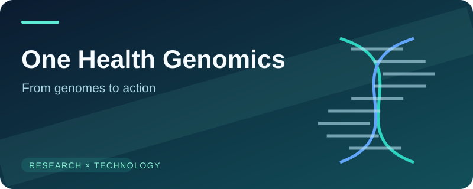

  

  <h1>Hi, I'm Thanh Trung Nguyen 👋</h1>
  
<strong>PhD · Computational biologist · Research software builder</strong>

  

    I connect <strong>genomics, protein biology, machine learning and software engineering</strong> 
    to translate complex biological data into practical research tools.
  

  

    <a href="https://genomessages.com/">🌐 Genome Messages</a>
    &nbsp;·&nbsp;
    <a href="https://github.com/thanh727">💻 GitHub: @thanh727</a>
  

---

### 🔬 About my work

I hold a PhD in molecular and cell biology. My background spans **structural biology**, **pathogen population genomics**, **molecular microbiology** and **data science**. I combine experimental research with computational methods to investigate biological mechanisms and develop reproducible, deployable solutions.

- **Discover** — Genomic diversity, pathogen adaptation and genotype–phenotype relationships.
- **Model** — Protein structure–function relationships, machine learning and biological interpretation.
- **Translate** — Molecular diagnostics, vaccine-antigen discovery and scientific software.

### ✨ Selected work

<table>
  <tr>
    <td width="50%" valign="top">
      
      <h3>AssayForge</h3>
      A research software platform for literature-assisted assay discovery, primer/probe design and molecular assay workflows.
        <strong>Topics:</strong> Molecular diagnostics · Bioinformatics · Web applications
    </td>
    <td width="50%" valign="top">
      
      <h3>One Health Genomics</h3>
      Integrating population genomics, protein biology and ML to investigate pathogen diversity, disease association and vaccine targets.
        <strong>Topics:</strong> AMR · Zoonoses · Translational research
    </td>
  </tr>
  <tr>
    <td width="50%" valign="top">
      
      <h3>Data into Decisions</h3>
      Building reproducible workflows for microbiology, epidemiology, visualization and statistical analysis.
        <strong>Topics:</strong> Python · Statistics · Applied AI
    </td>
    <td width="50%" valign="top">
      <h3>📖 Genome Messages</h3>
      
Sharing perspectives, methods and practical tutorials at the intersection of clinical biology, bioinformatics and data science.

      
<strong>Explore:</strong> <a href="https://genomessages.com/">genomessages.com</a>

      
Research is more useful when methods are documented, reusable and accessible.

    </td>
  </tr>
</table>

### 🧰 Research & engineering toolkit

| Domain | Methods and technologies |
| :--- | :--- |
| **Programming & data** | Python · R · SQL · Bash · Git |
| **AI & quantitative analysis** | Machine learning · Statistical modeling · Data visualization |
| **Computational biology** | Population genomics · Sequence analysis · Protein structure–function analysis |
| **Research engineering** | Scientific workflows · Web applications · Reproducible pipelines |
| **Experimental biology** | Molecular diagnostics · Assay development · Microbiology |

### 🎯 What guides my work

> **A useful scientific result should be interpretable, reproducible and translatable into action.**

I enjoy projects that connect basic mechanisms to real-world applications, especially in **infectious diseases, antimicrobial resistance, One Health and computational diagnostics**.

### 🤝 Connect & collaborate

I'm interested in research collaborations, open-science tooling and interdisciplinary projects that bring **wet-lab biology and modern computation** together.

**Website:** [Genome Messages](https://genomessages.com/) · **GitHub:** [@thanh727](https://github.com/thanh727)

  From genomic evidence to biological understanding — and from understanding to useful tools.

